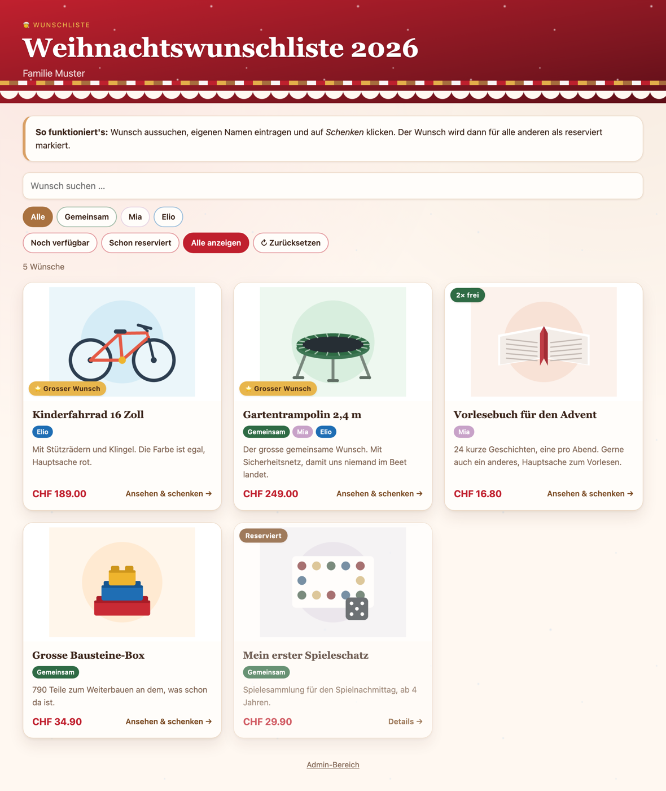
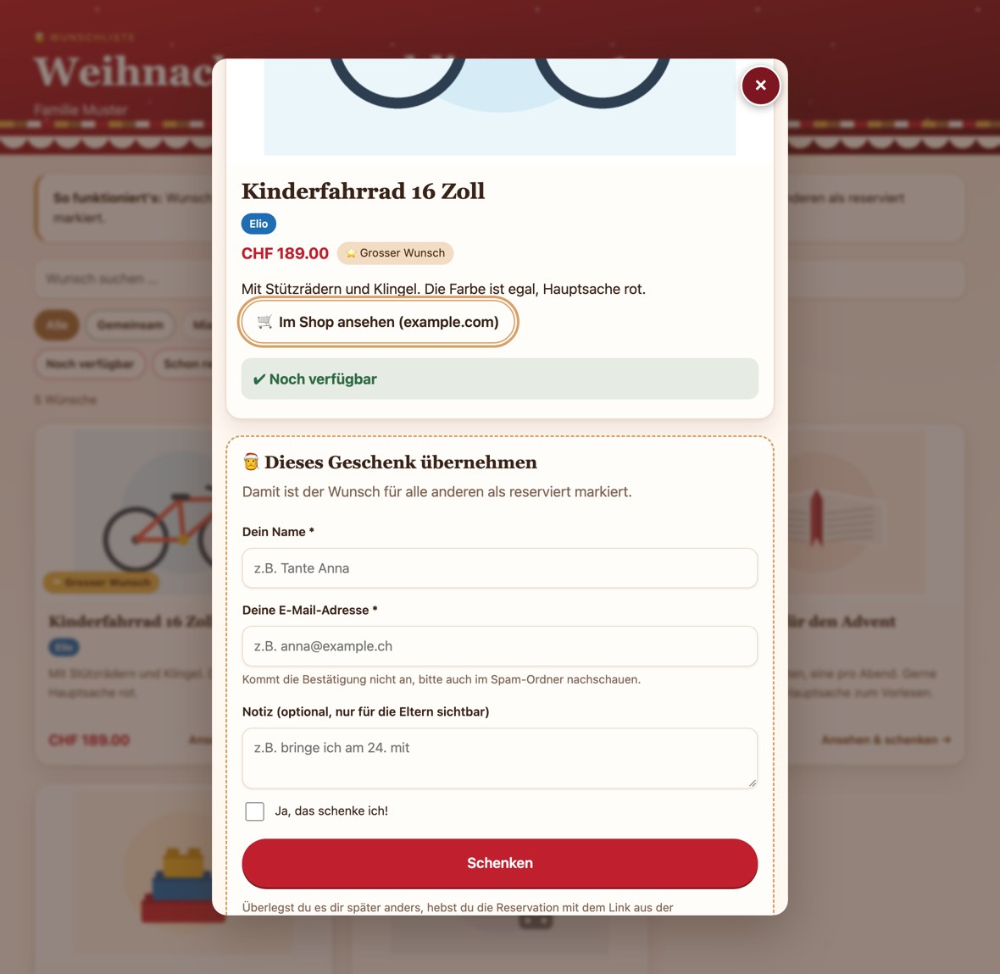
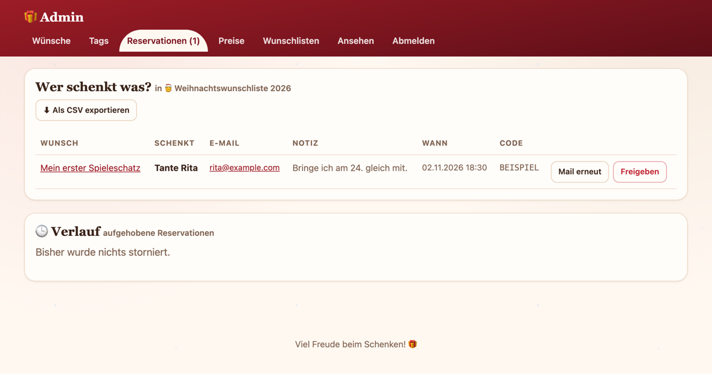

# Wunschliste

Eine kleine PHP-Seite für Geschenk-Wunschlisten in der Familie. Wünsche erfassen, den Link
an die Verwandtschaft geben, und wer etwas übernimmt, trägt seinen Namen ein. So bekommt
niemand etwas doppelt, und die Kinder müssen nicht wissen, wer was besorgt.

Gespeichert wird in JSON-Dateien im Ordner `data/`. Eine Datenbank braucht es nicht, ein
einfaches PHP-Hosting reicht. Entstanden ist das Ganze für die Weihnachtswünsche unserer
Kinder; inzwischen kann es auch Geburtstags-, Oster- und sonstige Listen.



## Schnellstart

Lokal ausprobieren, mit den mitgelieferten Beispieldaten:

```bash
git clone https://github.com/dein-konto/wunschliste.git
cd wunschliste
cp config.example.php config.php
cp beispiel/*.json data/ && cp beispiel/bilder/* uploads/
php -S localhost:8000
```

Dann [http://localhost:8000](http://localhost:8000) öffnen. Der Admin-Bereich liegt unter
`/admin.php`, das Passwort steht in der `config.php` und lautet anfangs `bitte-aendern`.

Auf dem Webspace läuft es gleich: alle Dateien per FTP hochladen, `config.example.php` als
`config.php` kopieren und anpassen, danach `data/` und `uploads/` beschreibbar machen
(meist 755, bei manchen Hostern 775). Die Beispieldaten kann man weglassen, dann startet
die Seite mit einer leeren Liste und legt sie beim ersten Aufruf selbst an.

Voraussetzung ist PHP 8.0 oder neuer. Der Zugriffsschutz der Datendateien setzt auf
`.htaccess` und damit auf Apache; zu nginx steht weiter unten etwas.

## Screenshots

Ein Klick auf einen Wunsch öffnet ihn als Dialog über der Liste. Name und Mailadresse
eintragen, bestätigen, fertig.



Im Admin-Bereich steht, wer was übernommen hat. Reservationen lassen sich einzeln wieder
freigeben, aufgehobene stehen im Verlauf.



## Was die Seite kann

* **Mehrere Wunschlisten** nebeneinander, etwa Weihnachten 2026, Geburtstag 2027, Ostern.
  Jede Liste hat eigene Wünsche, eigene Tags, ein eigenes Design, ein eigenes
  Gäste-Passwort und lässt sich einzeln an- und abschalten.
* **Wünsche** mit Bild, Titel, Beschreibung, Preis, Shop-Link und Tags.
* **Filter** nach Tags und Status. Standardmässig erscheinen nur die noch freien Wünsche.
* **Schenken**: Name eintragen, bestätigen, der Wunsch ist für alle anderen reserviert.
* **Bestätigung per Mail**, aufgebaut wie eine Bestellbestätigung im Shop: Bild, Titel,
  Preis, Link zum Shop zum späteren Kaufen und ein Link, um die Reservation selbst wieder
  aufzuheben.
* **Verlauf**: aufgehobene Reservationen bleiben im Admin nachvollziehbar.
* **Admin-Bereich** mit Passwort: Wünsche und Tags verwalten, sehen wer was schenkt,
  Reservationen freigeben, CSV-Export.
* **Import per Produkt-Link**: Shop-Adresse einfügen, die Seite liest Titel, Bild,
  Beschreibung und Preis heraus und füllt das Formular zum Prüfen aus.
* **Suche**, die beim Tippen sucht. Das x im Feld setzt sie zurück.
* **Für das Handy gebaut**, funktioniert ebenso auf dem Desktop.
* Ohne JavaScript öffnet sich statt des Dialogs die Detailseite `gift.php`. Alles
  funktioniert also auch dann.
* Suchmaschinen bleiben aussen vor, über `robots.txt` und `noindex`.

## Einstellungen

Alles Wichtige steht in der `config.php`, die aus `config.example.php` entsteht und
bewusst nicht im Git liegt:

| Schlüssel | Bedeutung |
|---|---|
| `admin_password` | Passwort für `admin.php`. Darf auch ein Hash aus `password_hash()` sein. |
| `contact_hint` | Wie man euch erreicht, falls jemand mit dem Storno nicht weiterkommt. |
| `session_days` | Nach wie vielen Tagen Passwörter neu eingegeben werden müssen. |
| `smtp_*`, `mail_*` | Postfach für die Bestätigungsmails. Leer lassen schaltet den Versand ab. |
| `site_url` | Adresse der Seite für die Links in der Mail. Leer heisst: wird aus dem Aufruf abgeleitet. |
| `currency` | Währung für die Preisangaben. |

Die drei Schalter `show_reserver_names`, `show_reserved_gifts` und `send_mail` stehen pro
Wunschliste im Admin. In der `config.php` ist nur hinterlegt, womit eine neu angelegte
Liste startet.

Statt des Klartext-Passworts kann auch ein Hash in der `config.php` stehen:

```bash
php -r 'echo password_hash("meinpasswort", PASSWORD_DEFAULT), "\n";'
```

Die Ausgabe beginnt mit `$2y$` und kommt als `admin_password` in die Datei.

Nach einer Änderung an der `config.php` kann es ein paar Sekunden dauern, bis der Server
sie übernimmt. Das ist der PHP-Opcache; kurz warten und neu laden genügt.

## Mehrere Wunschlisten

Im Admin unter **Wunschlisten**. Pro Liste einstellbar:

| Feld | Bedeutung |
|---|---|
| Name, Untertitel | steht oben auf der Seite |
| Design | eines von zehn, siehe unten |
| Gäste-Passwort | wer es eingibt, landet automatisch auf genau dieser Liste |
| Adresse | `index.php?l=weihnachten-2026`, wird aus dem Namen gebildet |
| Aktiv | abgeschaltet ist die Liste auch mit Passwort zu |
| Offen ab, offen bis | optionaler Zeitraum, ausserhalb davon ist die Liste zu |
| Standard | diese Liste erscheint, wenn jemand die Seite ohne Link aufruft |
| Reservierte sichtbar | reservierte Wünsche bleiben markiert stehen oder verschwinden |
| Namen zeigen | ob Besucher sehen, wer reserviert hat |
| Bestätigungsmail | ob nach dem Schenken eine Mail verschickt wird |

Auch die **Tags gehören je einer Liste**. Eine Weihnachtsliste hat vielleicht ein Tag pro
Kind und eines für den gemeinsamen Wunsch, eine Geburtstagsliste ganz andere. Verschiebt
man einen Wunsch in eine andere Liste, fallen die Tags darum weg.

**Passwörter verteilen**: Jede Liste bekommt ihr eigenes. Die Verwandtschaft ruft die
Startseite auf, gibt das Passwort ein und wird auf die richtige Liste geleitet. Man muss
also keine Adressen verschicken. Wer mehrere Passwörter kennt, sieht unten eine Leiste mit
den anderen Listen.

**Abgeschaltet oder ausserhalb des Zeitraums**: Besucher bekommen eine kurze Mitteilung zu
sehen, das Passwort hilft dann nicht weiter. Als angemeldeter Admin siehst du die Liste
weiterhin, mit einem Hinweis, dass sie für Besucher gerade zu ist. So lässt sich eine Liste
in Ruhe vorbereiten und erst später freigeben.

Gelöscht wird eine Liste mitsamt ihren Wünschen, Tags und Bildern. Die letzte verbleibende
Liste lässt sich nicht löschen.

## Designs

Beim Anlegen einer Liste wählbar:

| Design | Farben |
|---|---|
| Weihnachten, Rot und Lebkuchen | Weihnachtsmann-Rot, Lebkuchen, Schnee |
| Weihnachten, Schnee und Eis | Eisblau und Silber |
| Geburtstag Junge | Blau und Türkis, Konfetti |
| Geburtstag Mädchen | Pink und Flieder, Konfetti |
| Geburtstag Junge und Mädchen | Violett, Pink und Blau |
| Geburtstag neutral | Orange und Grün |
| Geburtstag Erwachsene | Dunkelblau mit Gold, ohne Konfetti |
| Ostern | Frühlingsgrün, Gelb, Flieder |
| Natur und Wald | Tannengrün und Holz |
| Schlicht | Grau und Blau |

Ein weiteres Design braucht einen Eintrag in `lib/themes.php` und einen Farbblock
`body[data-theme="…"]` in `assets/style.css`.

## Wenn zwei gleichzeitig schenken wollen

Das kann nicht schiefgehen, auf zwei Ebenen:

1. **Auf dem Server** wird die Datei beim Reservieren gesperrt (`flock`). Erst dann wird
   geprüft, ob der Wunsch noch frei ist, und geschrieben. Zwei gleichzeitige Reservationen
   laufen also nacheinander durch, und die zweite bekommt zu sehen, dass nichts mehr frei
   ist.
2. **Im Dialog** fragt die Seite alle 10 Sekunden nach, ob der offene Wunsch noch frei ist.
   Schnappt ihn jemand anders weg, erscheint sofort ein Hinweis, das Formular verschwindet
   und die Liste wird beim Schliessen aufgefrischt. Niemand füllt also minutenlang ein
   Formular aus, das nichts mehr bringt.

Bei mehrfach schenkbaren Wünschen wird die verbleibende Zahl im Dialog laufend nachgeführt.

## Produkt-Link importieren

Im Admin-Bereich oben: Adresse aus dem Online-Shop einfügen, auf *Daten holen* klicken, das
Formular darunter füllt sich mit Titel, Link, Beschreibung, Bild und Preis. Gespeichert
wird erst mit *Wunsch anlegen*, vorher lässt sich alles noch anpassen.

Gelesen werden Open-Graph-Angaben und JSON-LD-Produktdaten, also das, was auch WhatsApp
oder Facebook für ihre Linkvorschau verwenden.

**Nicht jeder Shop macht mit.** Viele funktionieren, manche grossen Händler sperren
automatische Zugriffe aber mit einem Bot-Schutz. Das ist eine bewusste Entscheidung des
Shops, und sie lässt sich nicht sauber umgehen. Wer es versuchte, müsste sich als Browser
oder als Suchmaschine ausgeben; darum macht diese Seite das nicht.

Bei einem gesperrten Shop passiert stattdessen Folgendes:

* Ein Hinweis, dass der Shop keine Abfrage zulässt.
* Der **Titel wird aus der Adresse abgeleitet** und aufgeräumt. Aus
  `…/lego-city-60502-flughafen-mit-flugzeug/p/253720` wird «Lego City 60502 Flughafen mit
  Flugzeug».
* **Bild einfügen statt suchen**: Bild im Shop kopieren und im Formular mit Strg+V oder
  Cmd+V einfügen, es landet direkt im Upload-Feld.
* **Preis nachtragen** über die Ansicht *Preise*: alle Wünsche untereinander, die ohne
  Preis zuoberst, daneben je ein Eingabefeld und ein Link auf die Shop-Seite.

Aus dem Browser heraus wäre es übrigens nicht besser. Die Shops erlauben keine
Cross-Origin-Zugriffe, der Browser würde die Antwort gar nicht erst herausgeben.

Das Häkchen **«Bild beim Speichern auf den eigenen Server kopieren»** lädt das gefundene
Bild nach `uploads/`. So bleibt die Liste vollständig, auch wenn der Shop das Bild später
verschiebt.

## Bestätigungsmail und Storno

Wer etwas schenkt, gibt Name und Mailadresse an und bekommt danach eine Bestätigung mit:

* Bild, Titel, Richtpreis und Beschreibung des Geschenks
* Link zum Shop, damit es auch später noch bestellt werden kann
* Link «Reservation aufheben» mit persönlichem Code
* Link zurück zur Wunschliste

Der Storno-Link führt auf `storno.php`. Dort steht zuerst, worum es geht, und erst ein
Klick gibt den Wunsch wirklich frei. Das ist Absicht, denn manche Mailprogramme öffnen
Links automatisch im Hintergrund. Ein Listenpasswort braucht es dafür nicht, der Code
selbst ist der Ausweis. Wer den Link verloren hat, kann den Code auch von Hand eingeben.

Jedes Storno landet im Admin unter *Reservationen* im **Verlauf**, mit Name, Mailadresse,
Zeitpunkt und der Angabe, ob die schenkende Person selbst storniert hat oder ihr im Admin.

Verschickt wird direkt per SMTP, nicht über `mail()`. Die Zugangsdaten stehen in der
`config.php`:

```php
'smtp_host'      => 'smtp.example.ch',
'smtp_port'      => 587,              // 587 = STARTTLS, 465 = SSL
'smtp_security'  => 'tls',            // 'tls', 'ssl' oder 'none'
'smtp_user'      => 'wunschliste@example.ch',
'smtp_password'  => '…',
'mail_from'      => 'wunschliste@example.ch',
'mail_from_name' => 'Wunschliste',
'site_url'       => 'https://wunschliste.example.ch',
```

Im Admin unter *Wunschlisten* steht, ob die Angaben vollständig sind, daneben liegt der
Knopf **«Testmail senden»**. Schlägt der Versand fehl, zeigt die Seite die Rückmeldung des
Mailservers im Klartext.

Damit die Mails nicht im Spam landen, sollte `mail_from` zu der Domain gehören, über deren
SMTP-Server verschickt wird.

**Ohne eingerichtetes SMTP** bekommt die schenkende Person den Storno-Code direkt auf der
Seite angezeigt. Reservieren funktioniert also auch ohne Mailversand.

## Zugriffsschutz der Dateien

Die Daten liegen in `data/` und die Bilder in `uploads/`. Geschützt wird das mit vier
`.htaccess`-Dateien:

* `.htaccess` im Hauptordner sperrt `data/` und `lib/` sowie alle versteckten Dateien,
  verbietet das Ausliefern von `.json`, `.bak`, `.lock`, `.log` und `.md`, schützt die
  `config.php` und schaltet das Verzeichnis-Listing ab
* `data/.htaccess` verweigert jeden Zugriff und schaltet PHP dort ab
* `lib/.htaccess` macht den Programmcode nicht direkt aufrufbar
* `uploads/.htaccess` lässt dort nichts ausführen, nur Bilder ausliefern

Alle `php_flag`-Anweisungen stehen in `<IfModule>`-Blöcken, damit es auf Servern ohne
mod_php keinen Fehler 500 gibt.

**Prüfen, ob der Hoster mitspielt**: Im Admin unter *Wunschlisten* gibt es den Knopf
**«Jetzt prüfen»**. Er ruft `data/gifts.json` über das Internet auf und sagt, ob die Datei
ausgeliefert oder gesperrt wird. Lokal bringt das nichts, der eingebaute PHP-Server kennt
keine `.htaccess`.

Auf **nginx** greifen diese Dateien nicht. Dort gehört eine entsprechende Regel in die
Server-Konfiguration:

```nginx
location ~ ^/(data|lib)/ { deny all; }
```

Die Reservationen sind bewusst **ohne Login für die Gäste**: Name eintragen genügt. Wer die
Liste öffnen kann, kann auch reservieren. Für den Familienkreis ist das in Ordnung und
spart allen das Anlegen von Konten. Ohne gesetztes Gäste-Passwort kann die Liste jeder
öffnen, der die Adresse kennt.

## Update auf dem Server

Beim Hochladen einer neuen Version diese drei Dinge **nicht überschreiben**, darin stecken
eure Daten:

| Nicht überschreiben | Was drinsteckt |
|---|---|
| `config.php` | Passwörter und Einstellungen |
| `data/` | Wunschlisten, Wünsche, Tags, Reservationen, Sitzungen |
| `uploads/` | alle Bilder der Wünsche |

Alles andere ist Programmcode und darf ersetzt werden: `index.php`, `gift.php`,
`admin.php`, `storno.php`, `robots.txt`, `.htaccess` sowie die Ordner `lib/` und `assets/`.

In `data/` und `uploads/` liegt je eine `.htaccess` und eine `index.html`. Die gehören zum
Code, sind aber bereits dort. Solange ihr die Ordner nicht löscht, bleibt alles, wie es
sein soll.

## Sicherung

Bei jedem Speichern legt die Seite eine Kopie der vorherigen Version an, etwa
`data/gifts.json.bak`. Für ein richtiges Backup genügt es, `data/` und `uploads/` per FTP
herunterzuladen. Im Admin gibt es zusätzlich einen CSV-Export der Reservationen.

## Aufbau

```
index.php           Übersicht mit Filtern und Suche
gift.php            Detailansicht und Formular zum Schenken
storno.php          Reservation aufheben, Link aus der Bestätigungsmail
admin.php           Admin-Bereich
config.example.php  Vorlage für die eigene config.php
lib/                Datenhaltung, Layout, Passwortschutz, Mailversand, Import
assets/             CSS und das bisschen JavaScript
data/               die JSON-Dateien, per .htaccess gesperrt
uploads/            hochgeladene Bilder
beispiel/           Beispieldaten zum Ausprobieren
```

Kein Composer, keine Abhängigkeiten, kein Build-Schritt.

## Beispieldaten

Im Ordner `beispiel/` liegt eine fertige Liste «Weihnachtswunschliste 2026» mit drei Tags
und fünf Wünschen, einer davon schon reserviert. Die Bilder sind selbst gezeichnete
Illustrationen, keine Produktfotos. Einspielen wie im Schnellstart oben; wieder loswerden,
indem man die Dateien in `data/` löscht.

## Lizenz

MIT, siehe [LICENSE](LICENSE).
